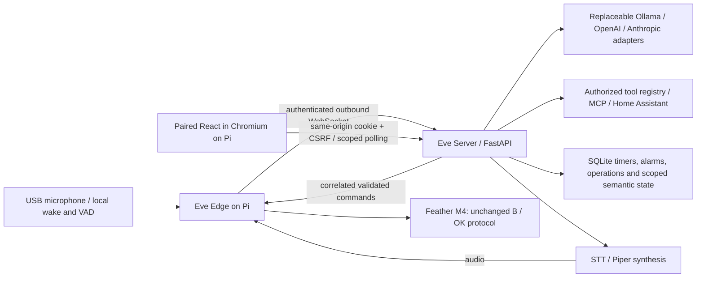

# Distributed architecture

Provider adapters, the tool registry/MCP client and temporary text sessions were
implemented in Phase 3. Phase 4 adds persistent timers/alarms, cached Open-Meteo,
restricted native HA/media, optional SearXNG and scoped application snapshots/events.
Phase 5 implements the configurable speech arrow with Pi wake/VAD, local server
faster-whisper/Piper and bounded return playback. Phase 6 implements the paired
browser boundary, semantic widgets and voice-driven display. Integrations were tested using fixtures; actual model
inference and physical audio acceptance are pending.

## Incremental boundaries

- `apps/edge`: network runtime, single serial owner, memory-only audio sender,
  durable command replay protection; optional `voice/` owns native-rate capture,
  wake/VAD, one output manager and a separate durable alarm/mute journal. Local hardware calls use the same service
  without depending on server connectivity or inference.
- `apps/server`: authenticated gateway, connection/request correlation, bounded
  audio assembler and snapshot service; provider-independent text orchestration,
  approved tools/MCP, persistent services and ephemeral conversation sessions. No serial, sounddevice, Torch or model
  weights are needed by the base backend installation. Optional `speech/` owns
  verified local server models, device-scoped voice turns, playback delivery and
  timer-cache reconciliation; it reuses the same orchestrator and tools.
- `packages/protocol`: strict Pydantic wire schemas; generated JSON Schema for
  future TypeScript generation. Protocol version changes require an explicit migration.
- `apps/server/services`: one SQLite owner, timer reconciliation, HTTP integration
  clients, operation receipts, scoped semantic state and durable event polling.
- `packages/application`: generated version-1 snapshot/event schema;
  `packages/weather`: pure normalization shared with retained legacy weather.
- `packages/audio`, `packages/assets`: validated PCM/metadata, local tones,
  cancellation ownership and shared trusted-manifest asset verification.
- `apps/server/browser`: persistent scoped sessions/pairing and adapters to existing
  services/agent/voice state, plus optional static hosting. No second event ledger.
- `apps/dashboard`: modular React store/transport/components/widgets, generated
  contracts, responsive layout and shader/static orb. See [Phase 6](PHASE6_DASHBOARD.md).
- `firmware/feather_m4`: retained firmware source and rollback baseline.
- `legacy/agent`, `legacy/client`: working earlier voice pipeline, retained until replaced.
- `training/wake_word`: training scripts and ignored local models/datasets.
- `tools/hardware`: standalone serial diagnostic client used by the legacy bridge.
- `deploy`: examples only. Do not automatically enable units or contact live hosts.

## Phase boundaries

1. Audit, repository hygiene, reproducible foundation dependencies, configuration,
   wire contract, tests and CI.
2. Authenticated outbound edge connection, correlated hardware acknowledgments,
   reconnect, bounded utterance transfer and simulated end-to-end tests.
3. Provider adapters, real normalized tool calling, permissions and temporary sessions.
4. Cached weather, SQLite timers, Home Assistant MCP/native adapters, search/media/UI tools.
5. Replace legacy file polling with wake/VAD capture, server STT and synthesis,
   edge playback acknowledgments, cancellation and follow-up listening.
6. Semantic React state, snapshots, real widgets, portrait/performance validation.
7. Local debounced presence/display policy, overrides and protected activity.
8. Production deployment validation, monitoring, backup/recovery, hardware benchmarks.

## Security and reliability rules

Device credentials are scoped to one configured device. Operator credentials are
separate; browser clients never receive them. TLS terminates at a trusted proxy
for LAN deployment. The gateway binds loopback by default. Secrets are loaded
from environment variables, excluded from logs and never included in snapshots.
Ollama is the default text provider. Cloud selection requires explicit opt-in;
there is no provider fallback. Text and tool data never switch providers mid-turn.

Hardware commands have deadlines and request IDs. A lost acknowledgment yields
an indeterminate result, never an automatic replay. Edge replay state survives
restart. A serial acknowledgment records a target only; actual brightness and
fade completion remain unknown with existing firmware. Network loss must not
close the local hardware service. Duplicate edge connections are rejected.

Audio is PCM16 mono at 16 kHz with explicit begin/chunk/end messages, sequence
numbers and byte counts. Frames, sessions, duration and idle time are bounded.
Incomplete uploads are discarded. Receipt acknowledges transport only. Negotiated
voice peers use the separate speech consumer; old peers retain the discard/test
consumer behavior. Playback has separate begin/chunk/end framing and software
started/progress/completed/cancelled/error receipts, never acoustic guarantees.

The edge suppresses microphone frames while muted, processing or playing. Wake
and VAD run locally; only bounded utterances leave the Pi. The server uses one
retained CPU INT8 STT worker and one Piper worker; optional dependencies and weights
are isolated from the edge/base server roles. Transcripts, responses and context
expire in memory. A separate delegated voice snapshot exposes scoped captions and
voice-owned widgets to trusted clients without changing application v1.

Backend timers remain authoritative. Complete snapshots populate a device-bound
edge cache, allowing finite local alarm tones through a bounded offline lease.
Alarm UUIDs are reserved durably before playback and uncertain attempts are never
replayed automatically. Playback does not acknowledge a pending timer. Alarm
priority and scheduling are independent of LLM/STT/TTS and ordinary speech mute.

Official implementation references:
[FastAPI WebSockets](https://fastapi.tiangolo.com/advanced/websockets/),
[websockets asyncio client](https://websockets.readthedocs.io/en/stable/reference/asyncio/client.html),
[Pydantic models](https://docs.pydantic.dev/latest/concepts/models/).

## Text agent boundaries (Phase 3)

- `apps/server/providers/`: native Ollama HTTP and official OpenAI Responses /
  Anthropic Messages SDK adapters. Private provider blocks remain internal and
  expire with context. No adapter executes tools itself.
- `apps/server/agent/`: normalized contracts, central prompt, bounded orchestration,
  principal/device-bound temporary sessions, cancellation and authenticated API.
- `apps/server/tools/`: schema registry, backend policy, executor, native time /
  correlated mirror tools and official MCP sessions. No alternate hardware path.
- `apps/server/auth.py`: shared credential comparison and optional scoped service /
  terminal principals. Existing operator and edge privileges remain separate.

The text API is non-streaming and independent of audio. Mutation permission is
explicit, sensitive/confirmation-required actions are blocked, and tool failures
are returned as tool data instead of promoted into instructions. Only allowlisted
MCP tools are registered; connections may recover before a new turn but failed
actions are not automatically retried. Conversation context and response text are
bounded and memory-only. Phase 4 adds durable turn replay markers and native
timer/HA operation receipts. Timer changes and receipts commit together; external
mutations reserve their identity before network I/O and retain unknown outcomes.
Native hardware idempotency remains durable at the edge.

See [PHASE3_AGENT.md](PHASE3_AGENT.md) for supported APIs, configuration, identity,
limits, MCP lifecycle and exact limitations.

See [PHASE4_SERVICES.md](PHASE4_SERVICES.md) for SQLite ownership/migrations,
timer recovery, native HA/media allowlists, configured HTTP destinations, weather
freshness and the separate authenticated application snapshot/event contract.
The original bearer-only semantic API remains private to trusted clients. Phase 6
adds a separate browser session API over the same services and events, delegated
to one explicit voice principal/device. It reads notifications before a transactional
full snapshot and retains the page cursor, preventing a missed state mutation
without adding a subscription race or new database. See [Phase 6](PHASE6_DASHBOARD.md)
for the reconciliation rule, privacy scope and restart behavior.

See [PHASE5_VOICE.md](PHASE5_VOICE.md) for speech ownership, trusted assets,
half-duplex/follow-up behavior, cancellation limits and offline alarm reconciliation.
