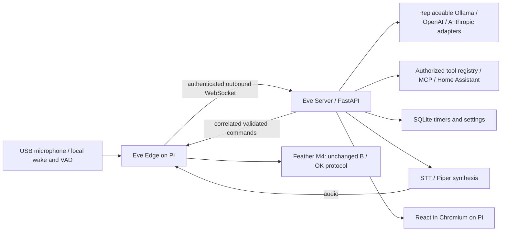

# Distributed architecture

The arrows beyond the foundation gateway describe the target, not implemented
capabilities. The implementation status is authoritative.

## Incremental boundaries

- `apps/edge`: network runtime, single serial owner, memory-only audio sender,
  durable command replay protection. Local hardware calls use the same service
  without depending on server connectivity or inference.
- `apps/server`: authenticated gateway, connection/request correlation, bounded
  audio assembler and snapshot service. No serial, sounddevice, Torch or model
  dependency in the default backend installation.
- `packages/protocol`: strict Pydantic wire schemas; generated JSON Schema for
  future TypeScript generation. Protocol version changes require an explicit migration.
- `dashboard`: retained React application; move components in small tested steps.
- `backlight Control/feather`: retained firmware source and rollback baseline.
- `deploy`: examples only. Do not automatically enable units or contact live hosts.

## Phase boundaries

1. Audit, repository hygiene, reproducible foundation dependencies, configuration,
   wire contract, tests and CI.
2. Authenticated outbound edge connection, correlated hardware acknowledgments,
   reconnect, bounded utterance transfer and simulated end-to-end tests.
3. Provider adapters, real normalized tool calling, permissions and temporary sessions.
4. Cached weather, SQLite timers, Home Assistant MCP/native adapters, search/media/UI tools.
5. Replace legacy file polling with wake/VAD capture, server STT and synthesis,
   edge playback acknowledgments, cancellation and follow-up listening.
6. Semantic React state, snapshots, real widgets, portrait/performance validation.
7. Local debounced presence/display policy, overrides and protected activity.
8. Production deployment validation, monitoring, backup/recovery, hardware benchmarks.

## Security and reliability rules

Device credentials are scoped to one configured device. Operator credentials are
separate; browser clients never receive them. TLS terminates at a trusted proxy
for LAN deployment. The gateway binds loopback by default. Secrets are loaded
from environment variables, excluded from logs and never included in snapshots.
No cloud fallback is enabled by the foundation.

Hardware commands have deadlines and request IDs. A lost acknowledgment yields
an indeterminate result, never an automatic replay. Edge replay state survives
restart. A serial acknowledgment records a target only; actual brightness and
fade completion remain unknown with existing firmware. Network loss must not
close the local hardware service. Duplicate edge connections are rejected.

Audio is PCM16 mono at 16 kHz with explicit begin/chunk/end messages, sequence
numbers and byte counts. Frames, sessions, duration and idle time are bounded.
Incomplete uploads are discarded. The phase-2 receiver acknowledges receipt;
transcription is a separate injected consumer, not a claimed capability.

Official implementation references:
[FastAPI WebSockets](https://fastapi.tiangolo.com/advanced/websockets/),
[websockets asyncio client](https://websockets.readthedocs.io/en/stable/reference/asyncio/client.html),
[Pydantic models](https://docs.pydantic.dev/latest/concepts/models/).
