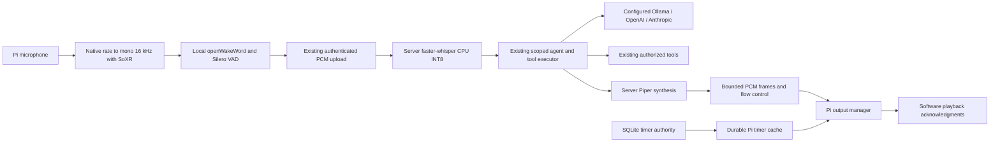

# Phase 5 distributed voice

Phase 5 extends the existing edge socket, audio assembler, agent, registry and
timers. The production path uses local openWakeWord/Silero, faster-whisper CPU
INT8, Piper and PortAudio. Tests inject model/audio fixtures into these interfaces
and use real authenticated loopback HTTP/WebSockets and the three provider SDKs.
No production endpoint, Pi, microphone, speaker, firmware or deployed service was
changed. Real model inference, speech quality and acoustic output remain unverified.



## Install isolated roles

The common development environment still uses `requirements/dev.lock` and
`pip install --no-deps -e .`; shared NumPy/SoXR conversion tests are now included.
Keep legacy/training environments separate. Choose the appropriate optional lock:

| Role | Lock | Includes |
|---|---|---|
| Transport-only Pi | `requirements/edge.lock` | Existing config/socket/serial dependencies |
| Voice Pi | `requirements/voice-edge.lock` | Edge plus openWakeWord, CPU ONNX Runtime, NumPy/SciPy/scikit-learn, SoXR, SoundDevice |
| Backend without speech | `requirements/server.lock` | Existing providers, MCP and services |
| Speech backend | `requirements/voice-server.lock` | Server plus faster-whisper/CTranslate2/PyAV and Piper; no speaker driver |

Use Python **3.11 for Linux/Pi voice**: openWakeWord 0.6.0 declares a Linux
`tflite-runtime` dependency whose pinned wheels require that environment. Eve uses
the ONNX path, without Torch or NVIDIA packages. Default transport/server and CI
remain Python 3.11/3.12. The combined locks were installed on Windows Python 3.12;
Linux/Pi wheel availability and native device setup still require acceptance.

Example Pi environment, to execute only in an authorized installation window:

```sh
python3.11 -m venv .venv-edge
.venv-edge/bin/python -m pip install -r requirements/voice-edge.lock
.venv-edge/bin/python -m pip install --no-deps -e .
.venv-edge/bin/python -m pip check
```

For the backend, use a separate environment and `requirements/voice-server.lock`
instead. Linux audio needs the OS PortAudio/ALSA runtime and appropriate device
permissions; follow the [SoundDevice installation guide](https://python-sounddevice.readthedocs.io/en/0.5.6/installation.html).
Do not install the backend, Whisper, Piper or training/CUDA stack on the Pi.

## Trusted model assets

There are no runtime model downloads. Restore the private Hey Eve export from its
trusted training output/backup; no public URL is assumed. Select exact upstream
feature/VAD/Whisper/voice revisions and obtain independently trusted SHA-256 values.
Record provenance/revision/licensing in private deployment records. Computing a
hash of an untrusted download does not establish its authenticity.

Start from [edge manifest](../deploy/voice/edge-assets.manifest.example.json) and
[server manifest](../deploy/voice/server-assets.manifest.example.json). Their hash
placeholders intentionally fail validation. Copy templates into ignored `.assets/`,
replace placeholders, and use separate role manifests. All paths resolve beneath
the selected asset root; missing/empty files, escaping symlinks and mismatched hashes
fail closed. Existing local training models are preserved rather than moved.

| Manifest name | Asset |
|---|---|
| `wake_word` | Private Hey Eve ONNX classifier |
| `melspectrogram`, `embedding` | Matching openWakeWord ONNX feature models |
| `silero_vad` | Silero ONNX with `input`, `state`, `sr`; 512 samples at 16 kHz, recurrent state `(2,1,128)` |
| Whisper entries | Every runtime file under `STT_MODEL_DIRECTORY`, including model, config, tokenizer and vocabulary/processor files supplied by that revision |
| `piper_voice`, `piper_config` | Matching Piper ONNX voice and JSON configuration |

Stage public downloads outside the runtime Whisper directory, then copy only the
publisher's runtime files there. **Every file** left in that directory must have
a manifest entry; leave download caches/metadata elsewhere. `model.bin`,
`config.json` and `tokenizer.json` are mandatory, preventing tokenizer-download
fallback. Add/remove vocabulary/processor template entries to match the selected
release exactly. Choose a CPU-compatible model directory, such as a reviewed
base/small English conversion, and point `STT_MODEL_DIRECTORY` at that directory.

```powershell
.\.venv-dev\Scripts\python.exe scripts/verify_assets.py --manifest .assets/edge-manifest.json --root .assets
.\.venv-dev\Scripts\python.exe scripts/verify_assets.py --manifest .assets/server-manifest.json --root .assets
```

Models load lazily and are reused. Optional server warmup is bounded. Failed server
loads cool down for 60 seconds before another requested attempt; there is no idle
reload loop. Edge initialization retries missing models with a 30-second delay;
device failures retry after three seconds while retaining successfully loaded models.
Piper accepts local `espeak`/`text` voices; extra downloadable phonemizers are
rejected and optional Arabic diacritization downloads are disabled.

## Configure and run

All settings extend `apps/config.py`; applications do not implicitly load `.env`.
Keep the existing distinct operator/device credentials and provider configuration.
See the complete [server example](../deploy/server/server.env.example) and
[edge example](../deploy/edge/edge.env.example).

Backend prerequisites:

- `EVE_SERVER_SPEECH__ENABLED=true` and verified `ASSET_ROOT`/`ASSET_MANIFEST`.
- `EVE_SERVER_VOICE_DEVICES` explicitly maps an authenticated device to
  `allow_mutations` and approved `home_entities`. A voice principal is
  `voice:<device_id>`, with only that mirror's device grant.
- Timer/home/brightness changes require both the voice grant's mutation permission
  and `EVE_SERVER_AGENT__ALLOW_MUTATIONS=true`. Home IDs must already be approved
  in `HOME__ENTITIES`. Sensitive/confirmation-required tools remain blocked.
- Set an explicit installed/tool-capable LLM as in [Phase 3](PHASE3_AGENT.md).
  Ollama remains default; cloud is explicit opt-in with no provider fallback.
  Raw audio always stays in the local STT/TTS path; selected cloud LLMs receive text.

STT is `faster_whisper`, CPU, INT8, four threads by default, one model worker and
one inference at a time. Configure `STT_MODEL_DIRECTORY`, `STT_LANGUAGE`,
`STT_TIMEOUT` (45 seconds) and optional `WARMUP`. Piper has its own retained worker,
`SPEAKER_ID`, length/noise scales, `TTS_TIMEOUT` (30 seconds), `MAX_TEXT` (4000),
and `MAX_RESPONSE_SECONDS` (60). These interfaces are replaceable without changing
the agent or socket. No Intel Arc, CUDA or alternate speech acceleration is claimed.

On the edge enable `EVE_EDGE_VOICE__ENABLED=true`, configure its manifest/root,
and use a writable private `STATE_PATH`. Exact unique PortAudio device names are
preferred; ambiguous names fail closed. `index:N` is an explicit unstable fallback.
Unset sample rates use the selected device's native default. Capture may use
44.1/48 kHz and multiple channels; channel averaging and stateful HQ SoXR conversion
produce correctly timed 16 kHz mono PCM. Output resamples separately to the speaker.
Gain and output volume are explicit, bounded settings.

```powershell
.\.venv-edge\Scripts\python.exe -m apps.edge.runtime --list-audio-devices
.\.venv-edge\Scripts\python.exe -m apps.edge.runtime --validate-voice-assets
.\.venv-edge\Scripts\python.exe -m apps.edge.runtime --voice --unmute
```

These commands use configured credentials. Asset verification via `scripts/verify_assets.py`
needs no service credentials. The edge defaults to software-muted on every start.
`--unmute` explicitly changes the running state and saved preference. To allow that
saved preference on later starts, also set `VOICE__MUTED_ON_START=false`; a saved
mute still wins. A corrupt/foreign voice journal fails closed. No microphone mute
is described as a hardware disconnect.

The existing systemd unit remains the single supervisor/serial owner. Deployment
must install its environment at `/opt/evemirror/.venv`, mount/read verified assets
outside protected home directories, and retain `/var/lib/evemirror` for both journals.
Verify audio groups, host API and device names under that actual service user.
Do not run the legacy supervisor or serial controller alongside the new runtime.

The Docker image remains speech-optional. Set the Compose build environment
`EVE_INSTALL_SPEECH=1`, enable the documented read-only model mount and configure
the speech settings before an authorized build/deployment. The named backend data
volume remains writable; models stay read-only. No Docker/systemd deployment ran here.

## Capture, sessions and half-duplex behavior

Wake classification runs locally on 80 ms frames; Silero uses 32 ms VAD frames.
Defaults require two wake hits above 0.5, simultaneous speech evidence, a three-second
cooldown, minimum 320 ms speech, 800 ms trailing silence and a five-second initial
speech timeout. Utterances are capped at 15 seconds, with at most 160 ms pre-roll
from the active listening window. The callback queue is bounded (32 blocks default).
An overrun discards that recording and resets capture; it does not stitch gaps into
a misleading utterance. Microphone errors close that stream and reopen with backoff.

After a wake, the output manager plays a local chime, drops queued chime/wake audio
and starts listening after a short configurable chime tail (0.05 seconds). Speak
after that chime; speech overlapping it can be clipped. During upload/processing,
speaker output and mute, ordinary capture/inference is suppressed. Native callbacks
discard suppressed samples before copying/queuing/resampling. The stream stays open;
it is not reopened for every assistant response. Buffer generations discard stale
work that completes across a suppression boundary.

After confirmed software playback, follow-up listening uses VAD without another
wake for up to 60 seconds. It requires real sustained speech/RMS evidence and
waits through the output echo tail (0.4 seconds). Silence expires back to wake mode.
Session leases cover active capture/STT/agent/synthesis/playback and release into
the bounded follow-up window; they do not create permanent conversations. Device
and principal identity always come from the authenticated connection, never audio
metadata. A new device gets a distinct session and tool scope.

The same orchestrator handles every provider and tool; no voice keyword router or
second executor exists. Tool failures produce conservative spoken failure wording;
an acknowledged but unverified HA state never becomes a confirmed spoken action.
Model/configuration failures can synthesize a concise local error response when
TTS is usable. Blank/invalid STT and broken speech/output paths report stable errors
and return to wake mode. They never auto-retry an uncertain action.

## Upload, delivery and cancellation

Existing `audio.begin/chunk/end/received` framing stays PCM16 little-endian, mono,
16 kHz, at most 30 seconds. New voice-capable peers receive `audio.received` after
validated receipt/acceptance, independently from processing. It proves neither STT,
tools, TTS nor playback. Older peers retain their transport-only behavior.

Hello capabilities negotiate additive v1 `voice`, `playback` and `timer_sync`
extensions. New `playback.begin/chunk/end/cancel/status` messages carry distinct
playback IDs, upload/session correlation, format, sample count/duration and exact
byte counts. Frames still fit the existing 24,000-byte limit; decoded chunks are
at most 16,000 bytes. Stop-and-wait acceptance/chunk receipts provide flow control.
The edge buffers at most one bounded complete response (60 seconds, 8–48 kHz mono).

Playback statuses mean:

| Status | Evidence |
|---|---|
| `accepted` / `buffered` | Validated allocation/byte receipt; no output yet |
| `started` | Output subsystem actually started; includes its observed UTC start |
| `progress` | Software source-sample position submitted to the driver |
| `completed` | All source samples processed and driver drain returned without detected error |
| `cancelled` / `failed` / `indeterminate` | Explicit stop, detected error/possible partial output, or outcome not known |

Software completion never proves measured acoustic output. No fabricated word-level
alignment is emitted. Response text, duration, actual start/progress and correlated
phases allow future captions without a synthetic subtitle timeline.

One voice turn and one output operation per mirror are active. Hardware commands
run through the existing replay-protected bridge in bounded background tasks, so
audio frames/heartbeats remain responsive. Programmatic local controls are
`runtime.voice.set_muted(bool)`, `cancel()` and `dismiss(alarm_uuid)`. A future physical
mute switch can call the same local method; the model has no unmute tool.

Operators can `POST /api/devices/<id>/voice/cancel` with the existing operator Bearer
credential. This cancels processing/synthesis/ordinary playback; it cannot undo an
issued tool action. Alarm dismissal is separate. Muting the microphone or cancelling
a voice answer preserves an active alarm; shutdown stops all output cleanly.
Full spoken barge-in/acoustic echo cancellation is not implemented.

Native model cancellation is cooperative. Timeouts/cancellation discard results,
signal the worker and retain its occupied slot until native inference finishes;
they do not start concurrent replacement work on that model. Shutdown waits for
owned native work. Measure actual cancellation latency on the target machine.

## Durable alarms and offline policy

Backend SQLite migration **2** adds `alarm_delivery` to the Phase 4 database.
Timer/alarm authority, unique alarm UUIDs and acknowledgment policy remain intact.
Delivery states are distinct from pending/acknowledged timer state. Sending or
playing a sound never acknowledges the timer. Interrupted started receipts become
indeterminate on backend restart/disconnect until reconciled.

An independent server task sends complete, paginated timer snapshots to each
approved mirror. `timer.sync_received` means the device committed that snapshot,
not that it played anything. Changed state sends promptly; unchanged state refreshes
every 30 seconds, and missing storage receipts retry after two seconds. Snapshots
are bounded to 1024 records, 16 per frame; partial/invalid snapshots never replace
the prior cache. No timer names, owners or conversation text are copied to the Pi.

The device-bound `edge-voice.sqlite3` journal stores schedules, mute preference,
pending explicit dismissals and alarm attempt receipts. It checks integrity/version
and rejects another device's database. Due checks use UTC deadlines with a monotonic
half-second wait. RUNNING/EXPIRED records can alert; PAUSED records cannot. The
software alarm tone is finite and generated locally; no LLM, STT or TTS is required.

Output priority is alarm, chime, ordinary speech. An alarm preempts ordinary speech;
simultaneous alarms play serially. A pending alarm that already played does not
interrupt subsequent responses again. The edge durably reserves an alarm UUID
before output; restarted reserved/started entries are indeterminate, preventing
automatic replay. Reconnect reports retained receipts with `replayed_receipt`,
which describes historical output rather than a new sound. Failed network status
writes do not interrupt a local alarm; its durable receipt reconciles later.
Receipt capacity defaults
to 10000; at capacity new attempts fail closed pending reviewed maintenance.

Offline scheduling is enabled by default for previously synchronized schedules,
within a 24-hour cache lease and a clock sanity check. No server connection or model
is needed for that path. It cannot discover a remote pause/cancel/ack while offline,
so it may alert from the last accepted snapshot. After the lease expires it waits
for a fresh authoritative snapshot. UTC/NTP correctness is required; clock jumps,
reboot and reconnect are tested with fake clocks, not a physical RTC.

This is at-most-once **attempt** handling, not exactly-once audible delivery. A crash
between reservation and output can leave an unheard, indeterminate alarm. Pending
backend records remain visible until explicit dismissal; inspect failure/unknown
receipts instead of erasing replay records or blindly issuing new actions. Offline
dismissals persist and are sent when connected, scoped to that device. Reconciliation
removes cancelled/acknowledged cache entries without inventing backend acknowledgment.
Offline audible acceptance remains pending actual Pi testing.

Use `scripts/backup_database.py` for a consistent SQLite backup, including WAL,
of either journal. Stop the relevant process before restore. Old backups can lose
newer identities; preserve permissions and inspect uncertainty before resuming.

## State, privacy and diagnostics

`GET /api/application/voice?after=<revision>` is a separate typed v1 volatile voice
snapshot/event API; the Phase 4 application schema remains unchanged. It uses the
same trusted backend authentication and rejects Origins/device credentials. Operators
qualify; scoped clients need explicit `allow_voice_state=true` and device grants.
That delegation includes those devices' **voice-owned** widget state. It does not
grant mutation rights or expose other clients' private timer/conversation scopes.
Do not put operator or service tokens in React; browser sessions remain Phase 6.

The response includes correlated transcript/response/phases, edge readiness/mute,
network condition, software playback events, voice-owned application snapshots,
and scoped durable alarm-delivery metadata. Caption history is bounded to 128 events
per device and defaults to 60-second retention; expired entries are removed from
memory. `resync_required` handles cursor loss/restart/retention. Captions are not a
durable event stream. `alarm_delivery.updated_at` is receipt/reconciliation time,
not a fabricated original acoustic timestamp. Pending timer state remains durable.

`/api/health` adds speech readiness/busy/error diagnostics. `voice.last_reported_edges` reports
local microphone/wake/VAD/output readiness, mute, RMS and measured stage timings;
device availability is last known software state, not a physical measurement.
Metrics cover wake/VAD inference, captured duration, upload, STT, agent/tools, TTS,
delivery/startup/software playback and total processing. Simulation timings include
fake engines and are not hardware/inference benchmarks.

No production audio/WAV handoff is written. Captions and model context stay bounded
in memory; completed speech-worker tasks release transcript/PCM results. Known
credentials are redacted from captions, tool results and final speech. SQLite still
contains private timer names, native receipts and scoped presentation state as
documented in Phase 4. Native model/SDK debug logging can expose content; keep normal
logging. The old legacy stack retains its separate recording/transcript behavior.

Regenerate contracts with `scripts/export_protocol.py` and
`scripts/export_application.py`: device/audio/voice messages are in
`packages/protocol/schema.json`, existing application v1 in
`packages/application/schema.json`, and the new HTTP voice contract in
`packages/application/voice.schema.json`.

## Validation and manual acceptance

Run the full Python suite, Ruff, `pip check`, schema consistency, original transport
simulation, frontend tests/typecheck/build and the focused voice scenarios:

```powershell
.\.venv-dev\Scripts\python.exe scripts/simulate_voice.py
```

This runs real socket scenarios with deterministic fake microphones, wake/VAD,
STT/TTS and speakers: all three provider adapters perform weather/home actions,
follow-up, brightness and timer tools; alarms run independently; failures, explicit
stop, privacy scopes, offline playback, lost receipts and restarts are exercised.
DSP tests use real SoXR/NumPy. Engine binding tests validate CPU/local-only parameters,
model reuse, trusted assets, metadata, concurrency/timeouts and cancellation.

Voice fixtures wait for matching controller/capture states, completion of the
previous turn, inactive output and the actual configured wake/echo deadlines
before emitting the next utterance. A speaker fixture's completed counter alone
does not establish listening readiness. The disconnect recovery case verifies a
second transcription and a new playback ID in SPEAKING before closing the socket.
An event-gated regression delays playback completion receipts and FOLLOW_UP,
checks that premature PCM is suppressed, and then completes a valid conversation
follow-up. Deliberate busy/mute tests inject raw frames separately. No larger
timeouts, flaky markers or production suppression changes are needed for this.

With independently verified assets, run the real-engine smoke paths separately:

```powershell
.\.venv-server\Scripts\python.exe scripts/speech_smoke.py stt --root .assets --manifest .assets/server-manifest.json --wav path/to/private-fixture.wav
.\.venv-server\Scripts\python.exe scripts/speech_smoke.py tts --root .assets --manifest .assets/server-manifest.json --output path/to/new-private-speech.wav
```

The STT fixture must be existing PCM16 mono/16 kHz WAV. Default output is metadata;
`--show-text` explicitly prints its private transcript. TTS saves only when given
`--output`, requires a new file and never plays server audio. These real-model paths
were documented but not run without trusted deployment manifests/models.

Physical acceptance is still required: verify actual OS/audio devices and service
permissions; restore/hash private models; stop legacy serial ownership; test wake
accuracy/cooldown, continuous capture at native 44.1/48 kHz, speech boundaries,
chime/echo tails, mute/restart privacy and microphone disconnect/recovery. Then test
truthful tool outcomes, speaker mismatch/disconnect/underrun, playback cancellation,
follow-up and alarms while speaking/offline/rebooting. Measure clocks, acoustic
output, end-to-end latency, CPU/RSS/temperature/throttling and Chromium responsiveness
under the selected models. No Arc acceleration, Pi performance or acoustic echo
cancellation result is claimed.

## Remaining legacy consumers and Phase 6

| Legacy modules | Status |
|---|---|
| `client/listen.py`, `client/runtime.py` | Replaced in the new path; retained as the old supervisor/capture rollback until physical acceptance |
| `agent/transcribe.py`, `tts_local.py`, `voice_loop.py`, `agent.py` | New voice uses the local providers/current agent instead; these still serve the retained legacy entry points |
| `dashboard_event_server.py`, `dashboard_events.py`, `tooling.py` | Still support the current React relay/weather contract; cannot retire before dashboard migration |
| `audition_tts_voices.py`, `smoke_test.py`, standalone serial diagnostics | Keep as legacy utilities; consider moving to `tools/` only after their callers/dependencies are separately validated |

Nothing in `legacy/` or firmware was retired in this phase. Phase 6 should implement
browser sessions with explicit device/voice scopes, connect React to typed snapshots
and durable/volatile cursors, split timer/weather/home/media/voice widgets, render
captions from actual software playback timing, and test reconnect/expiry/error states.
Then perform portrait/accessibility/performance work on the Pi. Retire old relay
and voice consumers only after replacements and physical acceptance pass.

Implementation references: [openWakeWord](https://github.com/dscripka/openWakeWord/tree/v0.6.0),
[Silero ONNX contract](https://github.com/snakers4/silero-vad/blob/master/src/silero_vad/utils_vad.py),
[faster-whisper](https://github.com/SYSTRAN/faster-whisper),
[Piper API](https://github.com/OHF-Voice/piper1-gpl/blob/main/docs/API_PYTHON.md),
[SoXR streaming conversion](https://python-soxr.readthedocs.io/en/stable/soxr.html).
